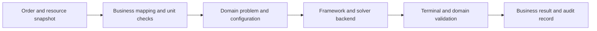

# From Business Examples to Your Application

After a first lesson, keep the small example application before adding an HTTP service: read one fixed input, make one real framework call and print independently checkable results. Add databases, queues and UI after input mapping, outcomes and error handling are stable.

## 1. Keep the Shortest Path

This is an application responsibility diagram, not a shared callable API. Framework entry points and return types differ. Do not discard original reports, quantities or errors to force them into a uniform interface.

| Layer | Include | Keep out |
| --- | --- | --- |
| Input adapter | Explicit conversion of order IDs, units, time, stock and resources | Silent zeros, dropped orders or merging distinct IDs by dimensions |
| Application orchestration | Domain problem, configuration, backend, budgets and extension wiring | A second implementation of existing conservation or overlap constraints |
| Business rules | Single-candidate policies or global modeling extensions | Discovering hard-rule violations only during report export |
| Output adapter | Validated plan, status, metrics, shortfalls and diagnostics | Presenting mocks, empty render objects or runs without a feasible solution as plans |

## 2. Change Five Things in Order

1. **Retain the hand-checkable baseline:** run the first-lesson business function and main before importing production orders.
2. **Confirm the execution path:** real backend examples need real backends; preserve heuristic semantics where documented. Configure backends for both restricted-master and final-integer phases in BPP2D/BPP3D and retain their reports.
3. **Handle request-boundary errors:** translate CLI errors into structured server responses and retain reports for normal runs without a solution. Entry points have different return types.
4. **Replace one data category at a time:** demand, then resources, then rules, preserving independently checkable invariants.
5. **Add infrastructure last:** databases, queues and UI; reject stale outputs and redact credentials and licenses from diagnostics.

Configure dependencies and native libraries using [Setup](./setup). First-lesson sources include imports; similarly named Kotlin/Rust constructors are not interchangeable.

## 3. Check Input Before Modeling

| Input | Business decision required |
| --- | --- |
| IDs and references | Unique identities and existing product, container, resource and node references |
| Counts and units | Integer pieces/rolls, explicit length/weight conversions and zero-demand treatment |
| Stock and bounds | Meaning of absent stock; distinguish `null`, zero and a missing field |
| Time and calendars | Time zone, allowed starts, intervals, frozen choices and execution facts |
| Objective | Priority of count, consumption, cost or service level, with explicit weight normalization |
| Budgets | Candidate, node, iteration and total-time limits, including how partial results are displayed |

Do not invent cancellation support where an entry point does not provide it; check backend capabilities. Prevent a cancelled or stale run from overwriting a newer schedule.

## 4. Success Still Requires Two Outcome Checks

Outer success means a report or result was returned. It may still describe infeasibility, a time limit without a feasible solution, a feasible solution found before a time limit or optimality. Read the actual language-specific fields and enums.

| Observation | Application action |
| --- | --- |
| Input or technical error | Return a locatable error; do not present an old plan as this run's success |
| Run completed without an acceptable plan | Show diagnostics; distinguish full-problem infeasibility from an insufficient pool |
| A feasible solution exists | Validate business feasibility and retain its real termination status |
| Current model proven optimal | Preserve model scope, candidate completeness, custom rules and evidence source |
| Geometry, stock or process validation fails | Do not deliver; retain input/report and inspect modeling or extraction |

A business response should retain request/input revision, configuration, actual backend, deliverability, original termination status, objective with units, plan, shortfalls and diagnostics. **This is an application design recommendation, not a common OSPF serialization schema.** Missing bounds/gaps remain unavailable, not zero.

## 5. Protect Integration with Three Test Groups

| Group | Examples | Acceptance |
| --- | --- | --- |
| Feasible baseline | One container, one pattern, two activities, four-node flow | Exact demand, geometry/process/conservation, resources and recomputed cost |
| Deliberately infeasible | Oversized item, frozen-calendar conflict, insufficient shared resource | No fabricated plan; correctly scoped conclusions |
| Boundaries and failures | Duplicate IDs, wrong units, zero stock, backend failure, time limit without a feasible solution | No silent input changes; technical errors separate from business outcomes |

Do not assert only the objective. Equivalent optima can differ in coordinates or activity order; prefer invariants and objective tolerances. Lock down a particular plan only when the business actually requires it.

Use second-lesson hand calculations to establish acceptance criteria for your application. Linked contract tests provide additional references for individual capabilities; validate the complete extended scenario with your own input and backend.

## 6. Continue with a Concrete Scenario

- [BPP1D: container types, stock and cost](./bpp1d/business-scenario)
- [BPP2D: sheet types, rotation and spacing](./bpp2d/business-scenario)
- [BPP3D: bin types and objectives](./bpp3d/business-scenario)
- [CSP1D: demand units and business rules](./csp1d/business-scenario)
- [CSP2D: kerf, cutting process and coils](./csp2d/business-scenario)
- [Gantt: calendars and rolling recovery](./gantt/business-scenario)
- [Network: shared resources, shortage and embedding](./network/business-scenario)

Determine rule ownership first: single-candidate rules belong in generation/policies; cross-candidate or cross-domain rules belong in a joint model. Use the [modeling workflow](/guide/modeling-workflow) and [solver result guide](/guide/solving-results), rather than extending by copying the solve loop.
